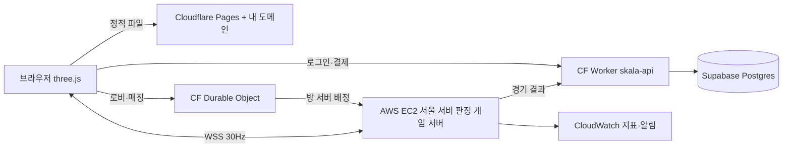

<!--
  Date: 06NOV2026
  Author: Minkyu Jung
  Purpose: 상용 출시 기획서. 결정 사항, 권리 정리, 이름·도메인, 캐릭터 아트 바이블, 작전 지휘소 UI, 서버 구조와 이전, 비용·수익, 유통, 단계별 일정과 완료 기준, 위험, 남은 결정.
-->
# 상용 출시 기획서

이 문서가 출시 작업의 기준이다. 구현은 이 문서의 결정과 완료 기준을 따른다. 바뀌면 이 문서를 먼저 고친다.

## 0. 결정 요약

| 항목 | 결정 | 상태 |
|---|---|---|
| 서버 구조 | **혼합 구성**: 정적 사이트·로그인·결제 API·로비는 Cloudflare, DB는 Supabase, **서버 판정 게임 서버만 AWS 서울** | 확정 |
| 게임 엔진 | three.js 유지. 엔진을 바꾸지 않는다 | 확정 |
| 캐릭터 | **무료(CC0) 모델을 고쳐 쓴다.** 현대 특수부대 세미 리얼 로우폴리(4절) | 확정 |
| 저작권 정리 | 문제 자산을 모두 바꾸고, **공개 저장소 기록에서도 음원을 지운다** | 확정 |
| 유통 | **내 도메인 + CrazyGames**(8절) | 확정 |
| 화면 스타일 | 어두운 작전 지휘소(팔란티어 느낌, 로고·이름은 쓰지 않음, 5절) | 확정 |
| 게임 이름 | 후보만 정리(3절) | **보류: 소유자 결정** |
| 도메인 | `.io`로 간다. 이름이 정해지면 산다. 그 전까지 바로 옮길 수 있게 준비만 한다 | **보류: 이름 결정 후** |

## 1. 목표와 "팔 수 있다"의 기준

다음을 모두 만족하면 출시할 수 있다.

1. **권리:** 화면·소리·모델·이름에 남의 저작물·상표가 없다. 모든 자산의 출처와 라이선스가 `docs/ASSETS.md`에 적혀 있다.
2. **법:** 사업자등록, 통신판매업 신고, 게임물관리위원회 등급분류(광고만 붙여도 필요)를 마쳤다.
3. **품질:** 데스크톱 60fps(16명 방), 중급 모바일 30fps. 첫 화면이 5초 안에 뜬다(일반 가정 회선).
4. **포털 조건:** 영어 지원, PEGI-12 수준 표현, 채팅 욕설 거르기, CrazyGames SDK(광고는 SDK로만).
5. **운영:** 서버 판정(핵 방지), 장애 대응 절차, 비용 알림, 결제 실서비스 키.

## 2. 권리 정리 (1단계, 가장 먼저)

### 2.1 바꿀 것

| 대상 | 문제 | 처리 |
|---|---|---|
| 이모트 음원 6개(`audio/emotes/*.bin`) | 출처·권리 기록이 없는 외부 음원(챌린지 영상의 곡으로 보임) | 지우고 게임 안 합성음으로 직접 만든 곡을 쓴다. 암호화 묶음 기능도 없앤다 |
| 이모트 8개의 이름·안무 | 다른 게임(RIVALS, Fortnite) 이모트를 따라 함. 짧은 안무도 저작권이 인정된다는 미국 항소심 판결(Hanagami v. Epic, 2023) | 새 이름과 직접 만든 동작. 판매된 이모트는 구매 기록(id)을 그대로 두고 이름·동작만 바꾼다 |
| 무기 `듀얼 우지`, `007 가방` | Uzi(IWI)·007(Danjaq) 상표 | `TW-2 쌍발 기관단총`, `BC-7 서류 가방` |
| 근접 무기·카드 `야스오의 검` | 리그 오브 레전드 캐릭터 이름과 기술 구성 | 이름을 바꾸고 기술 구성(순간이동 공중 연계)도 바꾼다 |
| `AS-12 스톰브레이커`, `GV-1 중력건` | 마블, 하프라이프 2 | `AS-12 템페스트`, `GV-1 특이점포` |
| 저격총 `SK-7`, 부두 맵 `SK-7 선석·울산` | SK 그룹 연상 | `SR-7`, 가상 항만 `K-7` |
| 좀비 `블리츠`(갈고리), `스피터` | 리그 오브 레전드, 레프트 4 데드 2 | `사슬꾼`, `산성 좀비` |
| `쿼드라·펜타·헥사 킬` | 리그 오브 레전드 아나운서 용어 | `쿼드 킬`, `5연속 처치`, `6연속 처치` |
| 연속 처치 음성 6개 | 윈도우 음성 합성 결과물. 상업 재배포 조건 미확인 | 상용 전 직접 녹음 또는 상업 이용이 명시된 음성으로 교체(소유자 결정) |
| 내부 id(`sm_uzi_dual`, `ml_yasuo`, `takeL` 등) | 화면에 안 보임. 서버 가격표·구매 기록과 묶여 있음 | 지금은 그대로 둔다. 바꾸려면 가격표·저장 데이터 이전을 한 번에 해야 한다(POINTS_SOP 사고 참고) |

### 2.2 저장소 기록에서 음원 지우기

- 지금 파일만 지워도 공개 저장소의 과거 기록(커밋 `d312d39`)에는 음원과 풀이 키가 남는다.
- 모든 브랜치를 다시 써서 음원 파일을 기록에서 지우고 강제로 올린다(git filter-repo). 쓰기 전에 전체 백업 묶음을 만든다.
- GitHub는 닫힌 PR의 옛 커밋을 따로 보관하므로 **GitHub 고객지원에 캐시·PR 기록 삭제를 요청**해야 끝난다(요청 문안은 `docs/HISTORY_PURGE.md`).
- **팀원이 할 일:** 옛 기록 위에서 작업한 클론은 버리고 새로 받는다. 옛 클론에서 push하면 음원이 되살아난다. 저장소의 push 검사(pre-push hook)가 이를 막는다.

### 2.3 함께 확인할 법적 사항 (소유자 확인 필요)

- **팀 프로젝트:** 이 저장소에는 다른 팀원(천성훈)의 커밋이 38개 있다. 판매하려면 공동 저작자의 동의(서면)가 필요하다.
- **교육 과정 약관:** SKALA 교육 과정의 결과물이면 그 약관의 지식재산권 조항을 확인한다.
- **브랜드:** "SKALA"는 SK AX의 교육 과정 이름이다. 판매 전에 게임 이름을 바꾼다(3절). 이름은 한 곳(`js/core/brand.js`)에서 바꿀 수 있게 만든다.
- **등급분류:** 광고나 결제를 붙이면 등급분류가 필요하다. 비영리 무료 공개면 면제 신청을 검토한다.
- **결제:** 사업자등록, 통신판매업 신고, 토스페이먼츠 실서비스 계약.

## 3. 게임 이름과 도메인

### 3.1 이름 후보 (2026-11-21 기준 `.io` 미등록 확인)

| 이름 | 도메인 | 뜻과 장점 | 확인한 충돌 |
|---|---|---|---|
| **FRONTGRID** (프론트그리드) | frontgrid.io | 전선 + 작전 격자. 작전 지휘소 화면 콘셉트와 바로 이어진다 | 같은 이름의 게임 못 찾음 |
| **KILOZULU** (킬로줄루) | kilozulu.io | 군 음성문자 K·Z. 짧고 군 작전 느낌 | 같은 이름의 게임 못 찾음 |
| **BREACHGRID** (브리치그리드) | breachgrid.io | 돌파 + 격자. 근접 교전 FPS 느낌 | 같은 이름의 게임 못 찾음 |

- 뺀 후보: `TACFRONT`(브라우저 게임 tacticfront.io와 헷갈림), `SECTOR ZERO`(같은 이름의 스팀 게임 여럿), `OPS ZERO`(Zero Ops라는 슈팅 게임 상표).
- 사기 전에 특허청 KIPRIS와 미국 USPTO에서 게임(제9류·제41류) 상표를 검색한다.

### 3.2 도메인

- Cloudflare에서 원가로 산다(AWS Route 53 도메인 구매는 지원금 대상이 아니다).
- 가격(Cloudflare 원가, 2026-10 기준): `.io` 첫해 $32, 갱신 $50. `.com` 첫해·갱신 $10.46. **`.com`이 더 싸다.** 비싸게 보였다면 그 이름의 `.com`이 프리미엄(재판매) 도메인이었을 가능성이 높다.
- `.io` 위험: 영국-모리셔스 차고스 조약은 아직 발효 전이고, 국가 코드가 사라져도 최소 5년 유예가 있다.
- 주소 구성(도메인을 `example.io`라 하면):

| 주소 | 용도 | 어디 |
|---|---|---|
| `example.io` | 게임 | Cloudflare Pages |
| `api.example.io` | 로그인·결제 API | Cloudflare Worker `skala-api` |
| `relay.example.io` | 로비·현재 중계 | Cloudflare Worker `skala-relay` |
| `game.example.io` | 서버 판정 게임 서버 | AWS EC2 서울 |

이전 절차는 `docs/MIGRATION.md`에 단계별로 있다.

## 4. 캐릭터 아트 바이블 (가장 중요)

### 4.1 방향

- **현대 특수부대, 세미 리얼 로우폴리.** 실제 사람 비율(7~7.5등신), 전술 헬멧·판 조끼·무릎 보호대.
- 블록·치비(머리 큰 비율)·복셀은 쓰지 않는다. kour.io의 블록 인형 느낌에서 확실히 벗어난다.
- 서든어택처럼 "현실적인 군인"이 기준이지만 특정 게임의 캐릭터 조합을 따라 하지 않는다.

### 4.2 기반 자산

| 용도 | 자산 | 라이선스 | 비고 |
|---|---|---|---|
| 몸체 | Quaternius **Ultimate Modular Men – SWAT** | CC0 1.0 | 7,752 삼각형, 다리·발·몸·머리 4부분, 62관절, 자체 동작 24개 |
| 같은 팩의 다른 부위 | Ultimate Modular Men의 다른 머리·몸 | CC0 1.0 | 대원마다 다른 실루엣을 만들 때 |
| 추가 동작(선택) | Quaternius Universal Animation Library 1·2 | CC0 1.0 | 이름 대응 재타깃이 필요. 다리 문제가 있으면 쓰지 않는다 |
| 이모트 | **직접 만든 안무**(코드로 쓴 키프레임) | 자체 | 2절의 권리 정리와 같은 작업 |

- 다운로드한 날짜, 원본 주소, 라이선스 파일을 모델과 함께 `assets/models/`에 둔다. Quaternius가 2026-08-28에 새 라이선스를 냈지만 소급하지 않으므로 받은 시점의 CC0 문서를 보관한다.
- Mixamo 모델·동작은 쓰지 않는다(원본 파일 재배포 제한, CC0 아님).

### 4.3 팀 구분과 색

| 층 | 블루 팀 | 레드 팀 |
|---|---|---|
| 전투복(팀 색을 어둡게) | 네이비 슬레이트 `#2B3A55` | 버건디 `#5A2A2E` |
| 장비(대원마다 다름) | 검정·코요테·올리브·회색 | 같음 |
| 강조(밝은 팀 색): 완장, 헬멧 띠, 어깨 패치, 적외선 표시등 | `#3F8CFF` | `#FF4F5E` |

- 멀리서도 팀이 보여야 한다. 강조색이 화면에 보이는 면적의 15~25%가 되게 한다.
- 실존 부대 휘장, 국기, 실존 브랜드 로고, 실존 위장 무늬(예: 상표 등록된 위장 패턴)는 쓰지 않는다. 무늬는 단색 또는 직접 만든 기하 무늬만 쓴다.

### 4.4 대원 7명 (id·가격은 그대로, 서버 가격표와 맞음)

| id | 이름 | 가격 | 실루엣(머리) | 장비 색 |
|---|---|---|---|---|
| `av_trooper` | 보병 | 0 | 전술 헬멧 + 바이저 | 검정 |
| `av_scout` | 정찰병 | 300 | 후드 + 이마에 올린 고글 | 올리브 |
| `av_sapper` | 공병 | 600 | 안전모 + 귀마개 + 헤드램프 | 코요테 |
| `av_signal` | 통신병 | 800 | 정찰모 + 헤드셋 + 등 무전기 안테나 | 올리브 |
| `av_ranger` | 사막 레인저 | 1000 | 챙 넓은 모자 + 선글라스 + 스카프 | 모래색 |
| `av_night` | 야간 작전병 | 1400 | 복면 + 야간 투시경 | 검정 |
| `av_heavy` | 중장갑병 | 2000 | 얼굴 가리개 헬멧 + 어깨 장갑 | 짙은 회색 |

- 실루엣은 머리 부분에서 확실히 달라야 한다(멀리서 실루엣만으로 구분).
- 몸 치수와 히트박스는 모두 같다.

### 4.5 기술 기준

| 항목 | 기준 |
|---|---|
| 키·히트박스 | 키 약 1.75 m, 머리 중심 1.62 m, 발이 원점, −Z를 본다. `consts.js HITBOX` 수치를 바꾸지 않는다. 디버그(F4)로 겹침 확인 |
| 폴리곤 | 대원 1명 10,000 삼각형 이하 |
| 파일 | 몸체 GLB 1 MB 이하(압축). 디코더가 따로 필요 없는 양자화를 우선 |
| 그리기 호출 | 대원 1명 6회 이하 |
| 성능 | 16명이 동시에 움직일 때 데스크톱 60fps. 먼 대원은 애니메이션 갱신을 줄인다 |
| 동작 | 서기, 걷기, 뛰기, 옆·뒤 이동, 앉기, 앉아 걷기, 조준(상체 위아래), 사격 반동, 재장전, 근접 공격, 투척, 쓰러짐, 이모트 11종 |
| 무기 | 3인칭 무기는 오른손 뼈에 붙인다 |
| 초상화 | 상점·내 정보의 초상화는 같은 모델로 그린다 |
| 보안 | 새 모듈(GLTFLoader 등)은 importmap integrity에 해시를 넣고 CSP 테스트를 맞춘다 |

## 5. 작전 지휘소 UI

### 5.1 디자인 토큰

| 토큰 | 값 | 쓰임 |
|---|---|---|
| 배경 0 | `#0B0F14` | 화면 바탕 |
| 배경 1 | `#11171E` | 패널 |
| 배경 2 | `#18202A` | 떠 있는 요소 |
| 선 | `#26313D` / 강한 선 `#3A4756` | 1 px 경계선 |
| 글자 | `#D8E1EA` / 흐린 글자 `#8494A6` | |
| 강조 | `#E8A33D` (호박색) | 주요 버튼, 선택 |
| 성공·위험 | `#3DBB78` / `#E5484D` | 상태 표시만 |
| 팀 | 블루 `#3F8CFF` / 레드 `#FF4F5E` | |
| 모서리 | 2 px | |
| 글꼴 | 본문 Pretendard, 숫자·좌표 JetBrains Mono (둘 다 OFL, 직접 호스팅) | |
| 작은 제목 | 대문자, 자간 0.08em, 11~12 px | |
| 움직임 | 120~180 ms, 튀는 효과 없음 | |

### 5.2 화면

| 지금 | 바뀐 이름 | 내용 |
|---|---|---|
| 메뉴 | **지휘소 (COMMAND)** | 가운데 3D 대원(회전 받침대), 오른쪽 요원 기록(전적·최근 작전), 아래 출격 버튼, 맨 위 상태 줄(● 운영 중 // 서울 // 시각 Z) |
| 모드 선택 | **작전 브리핑** | 위에서 본 지도, 목표, 위험도, 인원 |
| 방 목록 | **작전 구역** | 표(방 이름, 모드, 지도, 인원, 지연 시간) |
| 방 | **출격 대기** | 아군·적군 명단, 준비 상태, 출격 카운트다운 |
| 결과 | **작전 결과 보고서** | 처치·명중률·획득 포인트 |
| 상점 / 내 정보 | **무기고 / 요원 기록부** | |

- OS 이모지 아이콘은 직접 그린 SVG 선 아이콘으로 바꾼다.
- `index.html`의 예비 스타일(`--c-*`)과 `fps.css`의 토큰을 한 벌로 합친다.
- 영어 지원(포털 필수)은 다음 단계에서 문자열을 한곳에 모아 처리한다.

## 6. 서버 구조와 이전

- 지금 방식(방장 브라우저가 판정, Cloudflare 중계)은 그대로 두고, 서버 판정 서버가 완성되면 방 단위로 옮긴다.
- 이전 준비(이번 단계): 주소를 한 번에 바꾸는 도구(`tools/set-domain.mjs`), Cloudflare Pages 배포 설정과 보안 헤더(`_headers`), AWS 인프라 코드(`infra/aws`, Terraform), 절차서(`docs/MIGRATION.md`).
- GitHub Pages는 주소를 옮긴 뒤에도 한동안 그대로 두고 새 주소로 안내한다.

## 7. 비용과 수익

### 7.1 가정

1인 하루 25분, 방 8명, 최대 동시 접속 = 평균의 4배, 서버 판정 서버는 1인 시간당 약 60 MB 송신(`docs/SERVER.md` 측정값), 1달러 1,400원.

### 7.2 월 비용 (괄호는 하루)

| 구성 | 하루 300명 | 하루 3,000명 | 하루 3만 명 |
|---|---|---|---|
| 지금 구성 유지 | 약 4만 원 (1,400원) | 약 9만 원 (3,000원) | 약 60만 원 (2만 원) |
| **혼합 구성(채택)** | 약 9.5만 원 (3,200원), AWS 몫 약 5만 원은 지원금 | 약 57만 원 (1.9만 원) | 약 490만 원 (16만 원) |

- AWS 지원금 1,000달러는 1~2년 뒤 만료된다. 하루 300명 규모면 만료까지 쓰고, 하루 3,000명이면 2~3개월에 다 쓴다.
- AWS 비용의 70~80%는 송신 데이터다(서울 GB당 $0.126). 상태 압축과 가까운 플레이어만 보내기로 줄인다. 사람이 늘면 송신량이 묶음에 포함된 Lightsail도 검토한다.
- 첫날부터 AWS 예산 알림(50·80·100%)을 건다(`infra/aws`에 포함).

### 7.3 월 수익 (개발자 몫)

| 구분 | 하루 300명 | 하루 3,000명 | 하루 3만 명 |
|---|---|---|---|
| 광고(1,000판당 약 1,400~7,000원, 개발자 공개 수치) | 2~10만 원 | 19~95만 원 | 190~950만 원 |
| 유료 아이템(1%가 5,000원 결제 가정) | 약 6만 원 | 약 60만 원 | 약 600만 원 |
| 합계 | 8~16만 원 | 79~155만 원 | 790~1,550만 원 |

손익분기는 하루 300명 근처이고, 이익은 포털 노출(하루 3,000명)부터 난다. 사람을 모으는 것이 서버 선택보다 중요하다.

## 8. 유통: 내 도메인 + CrazyGames

| | CrazyGames | Poki |
|---|---|---|
| 독점 | 아니다. 다른 곳에 있어도 올릴 수 있다 | 수익 배분 계약은 웹 독점(기본 5년). 비독점은 1회 라이선스 비용 |
| 내 도메인 게임 | 아이프레임으로 넣을 수 있다(SDK를 넣어야 수익) | 독점이면 웹에서 Poki에만 |
| 수익 | 광고는 SDK로만. 개발자 몫 약 60%(잼 약관 기준), 월 €100 이상이면 지급 | 직접 데려온 플레이어 100%, Poki가 보낸 플레이어 50% |
| 조건 | 영어, PEGI-12, 원작성(복제·에셋 플립 불가), 채팅 욕설 거르기, 다른 포털 표시 금지 | 심사 후 제안 |
| 단계 | 기본 출시(광고 없음, 실제 지표 수집) → 정식 출시(광고) | |
| 멀티 서버 | 제공하지 않는다(우리 서버를 쓴다) | |

- **kour.io도 CrazyGames에 있다.** 개발사 LXV, 2024년 8월 출시, 외부 호스팅(아이프레임), 좋아요 약 41만. Poki와 구글 플레이에도 있다. 즉 "내 도메인 + 여러 포털" 방식이다.
- 우리도 같은 방식으로 간다. 내 도메인에서는 토스 결제, CrazyGames 안에서는 SDK 광고만 쓰고 토스 결제는 숨긴다(포털 약관).

## 9. 단계별 일정과 완료 기준

| 단계 | 내용 | 완료 기준 |
|---|---|---|
| 1. 권리 정리 | 2절 전부, 자산 장부, 기록 삭제 | 문제 자산 0개. 테스트 통과. 기록에 음원 없음 |
| 2. 이전 준비 | 주소 전환 도구, Pages 설정·보안 헤더, Terraform, 절차서, 브랜드 한곳 관리 | 도메인만 사면 절차서대로 1시간 안에 옮길 수 있다 |
| 3. 캐릭터 | 4절 | 7명 모두 새 모델. F4 히트박스 일치. 16명 성능 기준 |
| 4. 작전 지휘소 UI | 5절 | 모든 화면이 새 토큰. 데스크톱·모바일 화면 확인 |
| 5. 영어 지원 | 문자열을 한곳에 모으고 영어 번역 | 언어를 바꾸면 모든 화면이 영어 |
| 6. 서버 판정 | AWS 게임 서버를 클라이언트에 연결, 재접속, 로그인 확인 | 부하 시험으로 서버 1대당 동시 접속 수와 1인 비용을 잰다 |
| 7. 출시 | 사업자, 등급분류, 토스 실서비스, CrazyGames SDK·제출 | 실제 결제, 포털 기본 출시 |

## 10. 위험

| 위험 | 영향 | 대응 |
|---|---|---|
| 기록을 다시 쓴 뒤 팀원이 옛 클론으로 push | 음원이 되살아남 | pre-push 검사, 팀원 재클론 안내 |
| 공동 저작자 동의 없음 | 판매 불가 | 출시 전 서면 동의 |
| AWS 송신 비용 급증 | 지원금 조기 소진 | 예산 알림, 압축, Lightsail |
| 무료 모델이 흔해 보임 | 차별성 부족 | 머리 실루엣·색·장비를 직접 만든 부품으로 바꾼다 |
| 포털 심사 탈락(원작성) | 유통 막힘 | 4·5절의 독자적 아트와 UI |

## 11. 소유자가 정할 것

1. 게임 이름(3.1절 후보 또는 직접)
2. 연속 처치 음성: 직접 녹음 / 상업 이용 가능한 음성 서비스 / 음성 없이 효과음
3. 공동 저작자(팀원) 동의와 교육 과정 약관 확인
4. 사업자등록 시점
